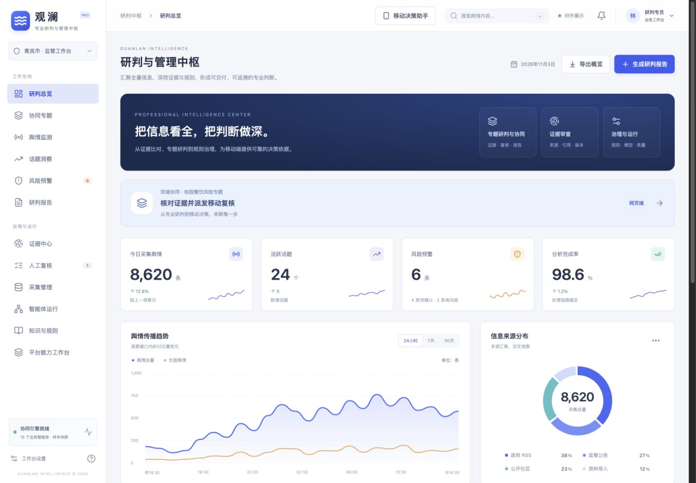
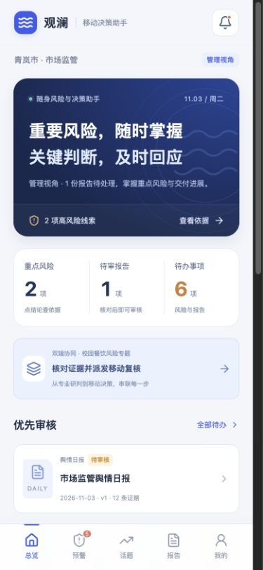

# 观澜 · 市场监管舆情智能协同平台

观澜围绕市场监管场景，将舆情监测、话题分析、风险研判、证据核查与报告交付连接起来，通过网页端和移动端演示专业研判与关键决策之间的协作。

当前仓库提供可交互的前端展示程序、界面截图和路演材料。界面使用内置样本，真实采集、外部模型、服务端存储与跨设备同步仍需接入。

## 双端定位

| 端     | 角色定位           | 主要使用者                   | 主要功能                                                     |
| ------ | ------------------ | ---------------------------- | ------------------------------------------------------------ |
| 网页端 | 专业研判与管理中枢 | 研判人员、业务负责人、管理员 | 全局监测、专题分析、证据与口径核验、报告编制、来源与版本治理 |
| 移动端 | 随身风险与决策助手 | 领导、值班人员、移动复核人员 | 重点风险、个人待办、证据速查、复核反馈、报告审核、变更跟踪   |

两端使用同一个 React 项目，通过 URL 中的 `?mobile=1` 切换。移动端目前采用适配手机的网页形态，无需单独安装 App。

## 核心特色

- **结论有出处**：从风险、专题或报告继续钻取原始证据，查看来源、文档编号、采集时间与版本。
- **数字有口径**：展示统计定义、结果编号、观察时间与覆盖范围，区分样本观察量和全网总量。
- **来源变化有响应**：演示来源撤回后原文禁读、关联报告引用失效、重新生成与再次审核。
- **判断职责明确**：模型负责内容理解，规则形成风险等级，业务人员完成关键复核与发布确认。
- **双端接续处理**：网页派发任务，移动端回传意见，网页形成报告，移动端审核发布，并保留处理轨迹。
- **运行配置可管理**：平台管理提供结论版本、来源控制、指标溯源、模型网关、任务调度、质量评测、领域扩展和运行保障的交互说明。

网页端还提供研判总览、舆情监测、话题洞察、风险预警、研判报告、证据中心、人工复核、采集管理、智能体运行和知识与规则等业务入口。

## 快速开始

本地需要安装 Node.js 和 npm。项目使用 React 19、TypeScript 和 Vite 6；当前开发环境的 Node.js 版本为 `26.8.2`。

```bash
git clone https://github.com/kai2dot0/aps_demp.git
cd aps_demp/guanlan-web
npm ci
npm run dev -- --port 5173
```

如果已经有本地代码，直接进入 `guanlan-web` 目录执行安装和启动命令即可。依赖未变化时，可跳过 `npm ci`。

启动后访问：

| 页面           | 地址                                          |
| -------------- | --------------------------------------------- |
| 网页端首页     | http://127.0.0.1:5173/#overview               |
| 移动端首页     | http://127.0.0.1:5173/?mobile=1#overview      |
| 事件台账       | http://127.0.0.1:5173/#collaboration          |
| 移动事件待办   | http://127.0.0.1:5173/?mobile=1#collaboration |

移动端可以将浏览器窗口缩窄到约 390px，或使用开发者工具中的手机设备模式。事件详情中的「移动工作台」在独立标签页打开同一事件，便于分别查看研判与核验工作。

按 `Ctrl+C` 停止开发服务。如果 5173 端口已被占用，以终端输出的实际端口为准。

### 在真实手机上访问

电脑与手机连接同一局域网，在 `guanlan-web` 目录运行：

```bash
npm run dev -- --host 0.0.0.0 --port 5173
```

然后在手机浏览器打开 `http://电脑的局域网IP:5173/?mobile=1#overview`。电脑需要允许该端口的局域网访问。

这可以在手机上体验界面。电脑与手机各自保存本地状态，当前尚不支持它们之间的业务数据同步。

## 事件办理与双端协作

### 可视化与研判大屏

首页提供观察趋势、热点风险气泡图、领域热力图和来源构成图。点击图表可查看话题或筛选领域；证据中心、风险详情、报告和指标工作台分别提供证据关系、关注阈值、版本变化与指标溯源。

点击网页顶部的「研判大屏」进入四个核心场景，也可以直接访问：

| 场景         | 本地地址                                      |
| ------------ | --------------------------------------------- |
| 证据追溯     | http://127.0.0.1:5173/#showcase/evidence      |
| 引用变更     | http://127.0.0.1:5173/#showcase/impact        |
| 分析任务     | http://127.0.0.1:5173/#showcase/agents        |
| 事件会商     | http://127.0.0.1:5173/#showcase/collaboration |

研判大屏收起业务导航，可切换场景、进入浏览器全屏并返回工作台。智能体回放支持暂停、继续和重置；回放为本地样本流程，不执行外部模型调用。来源撤回影响与双端协同均读取实际的浏览器工作区状态。

移动端将待办放在优先位置，补充风险等级分布、紧凑趋势、规则阈值和报告版本卡片。当前快照含 120 条可查看原文、10 个重点话题，覆盖五个监管领域。当前趋势、来源构成、领域热力、情感占比和预警数量均由同一批原文计算。7 / 30 天趋势的前期数据为单独标注的历史汇总，上一窗口汇总用于热度变化对比，不能当作可查原文。风险规则采用同一份阈值配置，生产规则仍需接入和验收。

### 事件办理

网页端「事件处置」提供五个监管领域、10 个事件的独立台账，可按领域、办理状态、事件名称和承办人筛选。每个事件包含概况、核验材料、研判报告和办理记录；移动端「待办」默认显示需要移动核验或审核的事项。

以「连锁餐饮后厨卫生与食材追溯」为例：

1. **派发核验**：网页端填写承办单位、承办人、未来办理期限和核验要求，点击「派发核验」。
2. **移动核验**：通过事件详情的「移动工作台」打开独立标签页，查阅材料并提交核验意见；材料不足时可退回补充。
3. **研判送审**：网页端填写研判结论与办理建议，点击「提交审核」。
4. **报告审批**：移动端可退回修改，或勾选材料确认后点击「审核通过」。退回修改后保留意见，再次送审生成新版本。
5. **办理归档**：网页端填写办结说明与后续安排，确认报告发布后点击「确认办结」。

来源撤回是独立的异常处理：在连锁餐饮事件的「核验材料」中登记撤回，关联报告暂停正文及导出，需要更新依据并重新审核。即使事件已办结，来源变化仍会将其重新标记为待更新。首次报告引用 18 条证据，撤回一条来源后，新版引用为 17 条。其他事件的报告不受无关来源变更影响。

「办理记录」保存实际派发、核验、审批和办结轨迹。恢复数据仅位于工作台设置，不再出现在日常事件办理页面。既有浏览器记录保持兼容，新事件状态不会覆盖原连锁餐饮事件。

两端同步依赖同一浏览器、同一源下的 `localStorage` 与存储事件。打开独立标签页演示时，请保持协议、主机名和端口一致，例如统一使用 `127.0.0.1:5173`，不要混用 `localhost`、其他端口或不同浏览器。

## 构建与验证

以下命令均在 `guanlan-web` 目录执行。

### 构建与预览

```bash
npm run build
npm run preview -- --port 4173
```

构建结果位于 `guanlan-web/dist/`。预览服务默认地址为 `http://127.0.0.1:4173/`，移动端仍通过 `?mobile=1` 切换。

### 运行已有测试

测试使用 Node.js 内置测试运行器，直接执行 TypeScript 文件，需要使用支持类型擦除的 Node.js 版本：

```bash
node --experimental-strip-types --test tests/*.test.ts
```

现有测试覆盖双端任务交接、操作顺序与输入校验、退回补充、来源撤回、报告重新审核和本地状态恢复。

## 目录结构

```text
.
├── README.md
├── guanlan-web/                  # 网页端与移动端前端项目
│   ├── src/
│   │   ├── main.tsx              # 根据 URL 选择网页端或移动端
│   │   ├── App.tsx               # 网页端业务界面
│   │   ├── MobileApp.tsx         # 移动端业务界面
│   │   ├── CollaborationWorkspace.tsx # 事件台账与双端办理工作区
│   │   ├── ControlCenter.tsx     # 平台能力工作台
│   │   ├── components.tsx        # 可复用界面组件
│   │   ├── workspaceStore.ts     # 本地共享状态与跨标签页同步
│   │   ├── mobileState.ts        # 业务状态与协同流程转换
│   │   ├── data.ts               # 内置业务样本
│   │   ├── capabilities.ts       # 设计能力目录
│   │   ├── styles.css            # 网页端样式
│   │   ├── mobile.css            # 移动端样式
│   │   └── collaboration.css     # 事件工作区样式
│   ├── tests/                    # 状态与协同流程测试
│   ├── package.json
│   └── vite.config.ts
├── ppt/                          # 双端协同版路演 PPT 与展示截图
├── output/                       # 其他已导出的路演 PPT
├── presentation-assets/          # 功能截图与报告素材
├── presentation-build/           # PPT 制作脚本、内容、渲染与校验记录
└── guanlan-preview.png           # 项目预览图
```

Git 仓库根目录位于最外层，前端安装、运行和构建命令仍需在 `guanlan-web` 中执行。`node_modules/`、`dist/`、本地环境文件与系统缓存不纳入版本管理。

## 路演材料与截图

- [双端协同版路演 PPT：20 页、15 分钟](ppt/观澜_OPC项目路演_双端协同版.pptx)
- [路演 PPT 导出文件](output/观澜_OPC项目路演.pptx)
- [双端协同工作区截图](ppt/观澜-双端协同工作区.jpg)

### 网页研判中枢



### 移动决策助手



`presentation-build/` 保留了 PPT 制作过程，其中脚本依赖原制作环境的绝对路径与 Codex 演示文稿运行库。重新生成 PPT 前需调整本地路径、截图位置和运行依赖；已导出的 PPT 可以直接下载使用。

## 当前实现范围

当前样本库位于 `guanlan-web/src/sampleData.ts`，`data.ts` 统一派生话题、预警和来源统计；两端共享报告引用、统计与导出逻辑。

| 监管领域 | 话题与原文数量                                               | 合计 |
| -------- | ------------------------------------------------------------ | ---: |
| 食品安全 | 连锁餐饮后厨卫生与食材追溯（18）、外卖配送食品安全（12）     |   30 |
| 消费权益 | 预付式消费退费与闭店争议（16）、家电售后维修与收费争议（12） |   28 |
| 价格监管 | 促销价格与优惠规则（14）、文旅住宿与停车收费（10）           |   24 |
| 产品质量 | 儿童用品质量与标识（10）、电动自行车电池与充电器质量（10）   |   20 |
| 特种设备 | 社区电梯运行维护（10）、商圈扶梯与公共设施安全（8）          |   18 |

每条记录包含文档 / 证据编号、来源、观察时间、话题、精确引文及核验边界。来源撤回保留历史快照计数，但停止原文读取，并使相关报告进入待更新状态。

升级样本库时，原共享工作区完整归档在本机 `guanlan-workspace-v2-archive-legacy`（后续升级按旧数据版本命名），再初始化新案例，防止旧审核结果用于新证据。当前工作区仍使用 `guanlan-workspace-v2`。已有 PPT 和历史截图保留原版本，不随本次数据更新自动重制。

- 可以运行并操作双端界面、样本筛选与钻取、人工复核、报告审核、协同交接及来源变更流程。
- 页面中的数据量、主体和处理结果属于内置样本，不代表真实客户、业务运行成绩或模型评测结果。
- 当前没有需要单独启动的后端服务，也无需配置真实模型 API Key。
- 真实采集、模型调用、数据库、身份权限、跨设备通知与同步，以及服务端索引、缓存和副本清理仍需建设和验收。
- 浏览器本地数据会随站点存储清理而重置，正式业务记录需要接入持久化存储。
