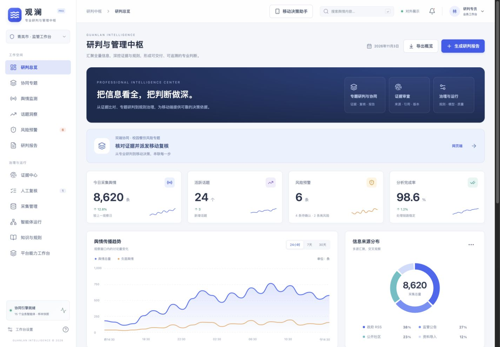
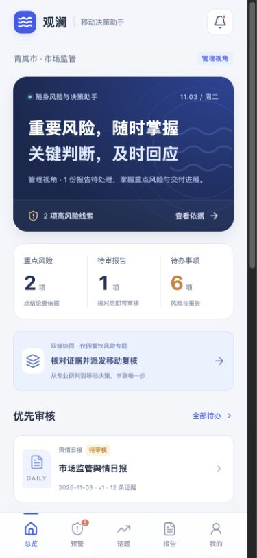

# 观澜 · 市场监管舆情智能协同平台

观澜围绕市场监管场景，将舆情监测、话题分析、风险研判、证据核查与报告交付连接起来，通过网页端和移动端演示专业研判与关键决策之间的协作。

当前仓库提供可交互的前端展示程序、界面截图和路演材料。界面使用内置样本，真实采集、外部模型、服务端存储与跨设备同步仍需接入。

## 双端定位

| 端 | 角色定位 | 主要使用者 | 主要功能 |
| --- | --- | --- | --- |
| 网页端 | 专业研判与管理中枢 | 研判人员、业务负责人、管理员 | 全局监测、专题分析、证据与口径核验、报告编制、来源与版本治理 |
| 移动端 | 随身风险与决策助手 | 领导、值班人员、移动复核人员 | 重点风险、个人待办、证据速查、复核反馈、报告审核、变更跟踪 |

两端使用同一个 React 项目，通过 URL 中的 `?mobile=1` 切换。移动端目前采用适配手机的网页形态，无需单独安装 App。

## 核心特色

- **结论有出处**：从风险、专题或报告继续钻取原始证据，查看来源、文档编号、采集时间与版本。
- **数字有口径**：展示统计定义、结果编号、观察时间与覆盖范围，区分样本观察量和全网总量。
- **来源变化有响应**：演示来源撤回后原文禁读、关联报告引用失效、重新生成与再次审核。
- **判断职责明确**：模型负责内容理解，规则形成风险等级，业务人员完成关键复核与发布确认。
- **双端接续处理**：网页派发任务，移动端回传意见，网页形成报告，移动端审核发布，并保留处理轨迹。
- **平台机制可展示**：能力工作台提供结论版本、来源控制、指标溯源、模型网关、任务调度、质量评测、领域扩展和运行保障的交互说明。

网页端还提供研判总览、舆情监测、话题洞察、风险预警、研判报告、证据中心、人工复核、采集管理、智能体运行和知识与规则等业务入口。

## 快速开始

本地需要安装 Node.js 和 npm。项目使用 React 19、TypeScript 和 Vite 6；当前开发环境的 Node.js 版本为 `26.8.2`。

```bash
git clone https://github.com/kai2dot0/aps_demp.git
cd aps_demp/guanlan-web
npm ci
npm run dev -- --port 5173
```

如果已经有本地代码，直接进入 `guanlan-web` 目录执行安装和启动命令即可。依赖未变化时，可跳过 `npm ci`。

启动后访问：

| 页面 | 地址 |
| --- | --- |
| 网页端首页 | http://127.0.0.1:5173/#overview |
| 移动端首页 | http://127.0.0.1:5173/?mobile=1#overview |
| 双端协同工作区 | http://127.0.0.1:5173/#collaboration |
| 独立移动协同页 | http://127.0.0.1:5173/?mobile=1#collaboration |

移动端可以将浏览器窗口缩窄到约 390px，或使用开发者工具中的手机设备模式。协同工作区内嵌了可操作的手机界面，适合在一块屏幕上展示两端交接。

按 `Ctrl+C` 停止开发服务。如果 5173 端口已被占用，以终端输出的实际端口为准。

### 在真实手机上访问

电脑与手机连接同一局域网，在 `guanlan-web` 目录运行：

```bash
npm run dev -- --host 0.0.0.0 --port 5173
```

然后在手机浏览器打开 `http://电脑的局域网IP:5173/?mobile=1#overview`。电脑需要允许该端口的局域网访问。

这可以在手机上体验界面。电脑与手机各自保存本地状态，当前尚不支持它们之间的业务数据同步。

## 双端协同演示流程

打开网页端的「协同专题」，以「校园餐饮风险协同研判」为例：

1. **网页派发**：查看证据、规则和观察口径，点击「派发移动复核」。
2. **移动复核**：在右侧手机界面查阅依据，填写并提交复核意见；材料不足时可退回补充。
3. **网页送审**：结合移动反馈填写研判结论与行动建议，点击「生成报告并送审」。
4. **移动审批**：核对证据、口径与建议，勾选确认项，点击「审核通过并发布」。
5. **来源变更**：网页端点击「演练来源撤回」，确认后查看原文与已发布报告的状态变化。
6. **网页更新**：依据仍可用的记录更新研判，点击「更新依据并重新送审」。
7. **移动重审**：核对新版本，点击「审核新版本并发布」，完成本专题的变更处理。

可通过「协同轨迹」查看交接记录，通过「恢复样本」重新体验流程。示例中的首次报告引用 4 条证据，撤回一条来源后，新版报告引用调整为 3 条。

两端同步依赖同一浏览器、同一源下的 `localStorage` 与存储事件。打开独立标签页演示时，请保持协议、主机名和端口一致，例如统一使用 `127.0.0.1:5173`，不要混用 `localhost`、其他端口或不同浏览器。

## 构建与验证

以下命令均在 `guanlan-web` 目录执行。

### 构建与预览

```bash
npm run build
npm run preview -- --port 4173
```

构建结果位于 `guanlan-web/dist/`。预览服务默认地址为 `http://127.0.0.1:4173/`，移动端仍通过 `?mobile=1` 切换。

### 运行已有测试

测试使用 Node.js 内置测试运行器，直接执行 TypeScript 文件，需要使用支持类型擦除的 Node.js 版本：

```bash
node --experimental-strip-types --test tests/*.test.ts
```

现有测试覆盖双端任务交接、操作顺序与输入校验、退回补充、来源撤回、报告重新审核和本地状态恢复。

## 目录结构

```text
.
├── README.md
├── guanlan-web/                  # 网页端与移动端前端项目
│   ├── src/
│   │   ├── main.tsx              # 根据 URL 选择网页端或移动端
│   │   ├── App.tsx               # 网页端业务界面
│   │   ├── MobileApp.tsx         # 移动端业务界面
│   │   ├── CollaborationWorkspace.tsx # 双端协同专题工作区
│   │   ├── ControlCenter.tsx     # 平台能力工作台
│   │   ├── components.tsx        # 可复用界面组件
│   │   ├── workspaceStore.ts     # 本地共享状态与跨标签页同步
│   │   ├── mobileState.ts        # 业务状态与协同流程转换
│   │   ├── data.ts               # 内置业务样本
│   │   ├── capabilities.ts       # 设计能力目录
│   │   ├── styles.css            # 网页端样式
│   │   ├── mobile.css            # 移动端样式
│   │   └── collaboration.css     # 协同工作区样式
│   ├── tests/                    # 状态与协同流程测试
│   ├── package.json
│   └── vite.config.ts
├── ppt/                          # 双端协同版路演 PPT 与展示截图
├── output/                       # 其他已导出的路演 PPT
├── presentation-assets/          # 功能截图与报告素材
├── presentation-build/           # PPT 制作脚本、内容、渲染与校验记录
└── guanlan-preview.png           # 项目预览图
```

Git 仓库根目录位于最外层，前端安装、运行和构建命令仍需在 `guanlan-web` 中执行。`node_modules/`、`dist/`、本地环境文件与系统缓存不纳入版本管理。

## 路演材料与截图

- [双端协同版路演 PPT：20 页、15 分钟](ppt/观澜_OPC项目路演_双端协同版.pptx)
- [路演 PPT 导出文件](output/观澜_OPC项目路演.pptx)
- [双端协同工作区截图](ppt/观澜-双端协同工作区.jpg)

### 网页研判中枢



### 移动决策助手



`presentation-build/` 保留了 PPT 制作过程，其中脚本依赖原制作环境的绝对路径与 Codex 演示文稿运行库。重新生成 PPT 前需调整本地路径、截图位置和运行依赖；已导出的 PPT 可以直接下载使用。

## 当前实现范围

- 可以运行并操作双端界面、样本筛选与钻取、人工复核、报告审核、协同交接及来源变更流程。
- 页面中的数据量、主体和处理结果属于内置样本，不代表真实客户、业务运行成绩或模型评测结果。
- 当前没有需要单独启动的后端服务，也无需配置真实模型 API Key。
- 真实采集、模型调用、数据库、身份权限、跨设备通知与同步，以及服务端索引、缓存和副本清理仍需建设和验收。
- 浏览器本地数据会随站点存储清理而重置，正式业务记录需要接入持久化存储。
